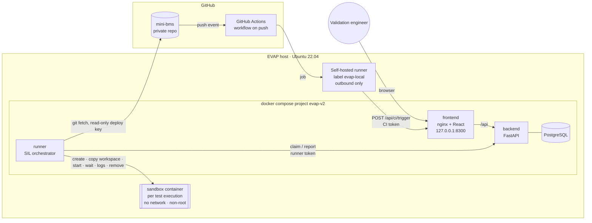
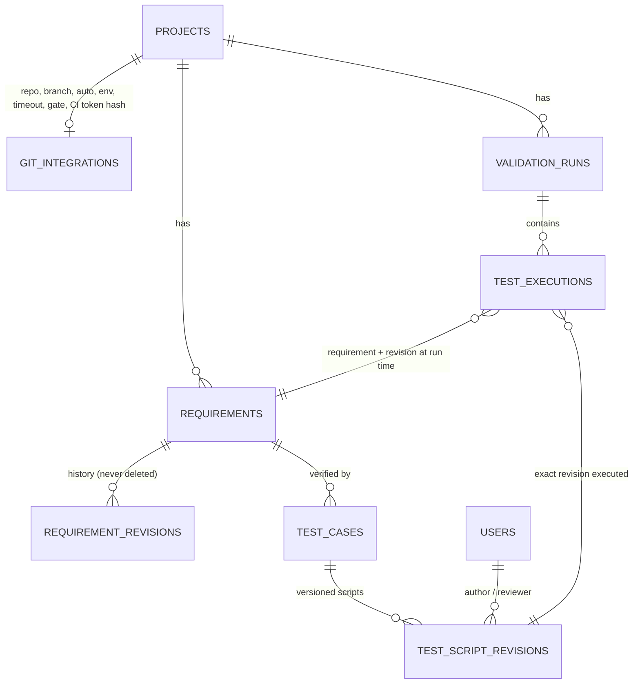
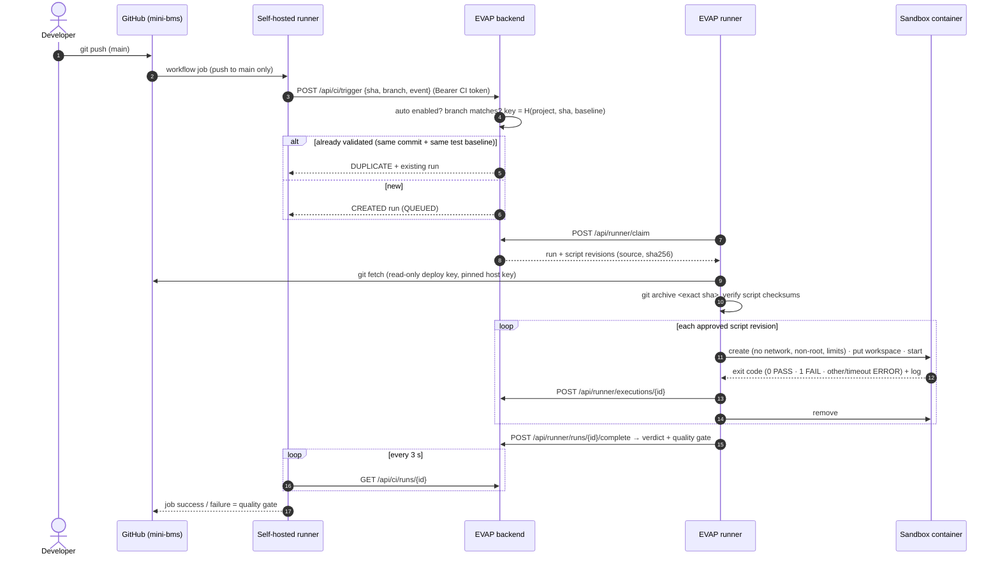

# EVAP Architecture

## 1. Components

| Component | Responsibility |
|---|---|
| **frontend** | React SPA (Overview, Requirements, Test Design, CI/CD Integration, Validation Results). nginx serves it and reverse-proxies `/api` to the backend. It is the only published port (`127.0.0.1` only). |
| **backend** | REST API, auth/RBAC, requirement revisions, Excel import, script registry (revisions, SHA-256, approval), run queue with idempotency, quality gate, metrics. Never executes test code. Runs read-only, non-root, on an `internal` network with no Internet access. |
| **db** | PostgreSQL 16; schema managed by Alembic (`backend/alembic/versions`), applied on backend start. |
| **runner** | Polls the queue (`FOR UPDATE SKIP LOCKED`), fetches the SUT repo mirror, resolves and archives the exact commit, launches one sandbox per approved script revision, reports verdicts and logs. |
| **sandbox** | Disposable `python:3.11-slim` + pytest image. Each test gets a fresh container: `network=none`, uid 10001, `cap_drop=ALL`, `no-new-privileges`, memory/CPU/PID limits, hard timeout, no mounts, no Docker socket, no credentials. |
| **self-hosted runner** | Official `actions/runner` registered **only** to the private SUT repo. It connects outbound to GitHub, so EVAP is never exposed publicly. |

## 2. Data model and traceability

Traceability chain: **Requirement (rev) → Test Case → Script Revision (rev, SHA-256, approver)
→ Test Execution (verdict, log, duration) → Validation Run (repo, branch, commit SHA, trigger,
quality gate)**.

Key constraints: unique `(project, req_id)`, `(project, tc_id)`, `(requirement, revision)`,
`(test_case, revision)`, `(run, script_revision)`; unique `validation_runs.idempotency_key`.

## 3. Dynamic test registry

No allowlist and no rebuild. The executable set is computed per run as *the latest **approved**
revision of each test case* of the project (`services/validation.py: executable_scripts`).
When a run is queued, EVAP snapshots exactly which revisions it will execute (one
`test_executions` row each) and stores a **baseline hash** over `(test_case, revision, sha256)`.
Saving a new draft never changes what runs. Only approval does.

## 4. Continuous validation sequence

## 5. Run states and quality gate

- Run / execution states: `QUEUED → RUNNING → PASS | FAIL | ERROR`.
- Run verdict: any FAIL → `FAIL`; else any ERROR → `ERROR`; else `PASS`. No approved scripts → `ERROR`.
- Quality gate policies: `all_pass` (every executed test passes) or `pass_rate` (≥ threshold %).
  Gate = `PASSED`/`FAILED`; the CI client exits 0/1 accordingly.
- Crash safety: on start-up the runner calls `/api/runner/recover`, which closes runs left `RUNNING` as `ERROR`.

## 6. Metrics (Overview)

Computed over the latest completed **regression** run (not single-test manual runs):
- **Mapping coverage**: requirements with ≥ 1 test case / all requirements (design-time).
- **Execution coverage**: requirements with ≥ 1 executed test in the latest campaign / all requirements.
- **Pass rate**: passed executions / executed tests in the latest campaign.

## 7. Key design decisions

| Decision | Reason |
|---|---|
| Runner polls the DB-backed queue via the API | No broker needed (no Redis/Celery); `SKIP LOCKED` allows several runners later. |
| One container per script revision | Tests cannot interfere with each other; cleanup is trivial. |
| Workspace copied in with `put_archive` | No host bind mounts, so the sandbox sees nothing of the host. |
| Self-hosted runner + localhost API | GitHub Actions reaches EVAP without any inbound port or tunnel. |
| SUT checked out by EVAP, not by the CI job | The verdict always refers to the commit EVAP itself fetched; the CI host never runs SUT code. |
| Single published port (nginx) | One origin for UI and API; strict CSP; backend unreachable from outside. |
