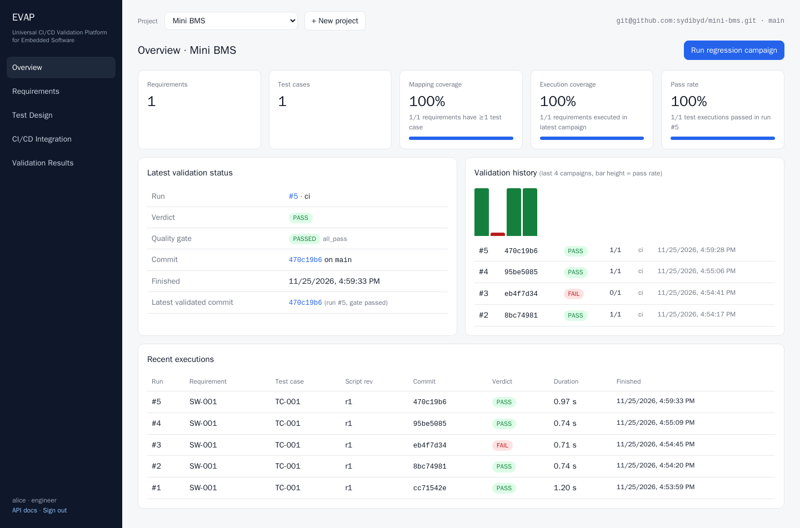

# EVAP — Embedded Validation Automation Platform

**A Universal CI/CD Validation Platform for Embedded Software Systems**

EVAP is a lightweight web platform for requirements-driven continuous validation of embedded
software. A validation engineer can run the whole lifecycle from the browser: requirements
(Excel SRS) → test cases → reviewed, versioned pytest scripts → SIL execution against the
**exact Git commit** → verdicts, logs, coverage and quality gate. A `git push` triggers it
automatically through GitHub Actions. Registering a new test never requires changing EVAP itself.

| | |
|---|---|
| Web UI | http://127.0.0.1:8300 (local only) |
| API docs (Swagger) | http://127.0.0.1:8300/api/docs |
| EVAP repository (public) | https://github.com/sydibyd/evap |
| Demo SUT (private) | https://github.com/sydibyd/mini-bms |



## Stack

FastAPI · SQLAlchemy 2 · Alembic · PostgreSQL 16 · React 18 + Vite + CodeMirror · nginx ·
pytest · openpyxl · Docker Compose · GitHub Actions (self-hosted runner). No Redis, Celery or
Kubernetes.

## Quick start (Ubuntu 22.04, Docker Engine + Compose v2)

```bash
git clone https://github.com/sydibyd/evap.git && cd evap
cp .env.example .env            # then replace every CHANGE_ME (see comments in the file)
#   python3 -c "import secrets; print(secrets.token_urlsafe(48))"   # for each secret
#   DOCKER_GID=$(stat -c %g /var/run/docker.sock)   RUNNER_UID=$(id -u)
mkdir -p secrets && chmod 700 secrets
# Private SUT repo: create a read-only deploy key and add its .pub to the SUT repo (Settings → Deploy keys)
ssh-keygen -t ed25519 -N "" -C evap-runner-readonly -f secrets/git_deploy_key
# Public HTTPS repo only? an empty file is enough:  touch secrets/git_deploy_key
docker compose up -d --build
```

Open http://127.0.0.1:8300 and sign in with `EVAP_BOOTSTRAP_ADMIN_USER` / `EVAP_BOOTSTRAP_ADMIN_PASSWORD`
(only used while no users exist). Then follow [USER_GUIDE.md](USER_GUIDE.md).

The compose project is named `evap-v2` and uses its own volumes, networks and port, so it runs
next to other stacks without touching them. Data persists in the `evap-v2_pgdata` volume across
`docker compose restart` and `down`/`up` (only `down -v` removes it).

## Repository layout

```
backend/        FastAPI app (app/), Alembic migrations (alembic/), API tests (tests/)
runner/         SIL runner: Git checkout of the exact commit + sandboxed pytest execution
sandbox/        Disposable SIL execution image (python 3.11 + pytest, non-root)
frontend/       React/Vite UI served by nginx (also reverse-proxies /api)
ci/             GitHub Actions workflow + stdlib CI client (evap_ci.py) for SUT repositories
examples/       SRS_mini_bms.xlsx, empty SRS template, TC-001 pytest script
scripts/        Acceptance tests: UI demo (Playwright), push PASS/FAIL/PASS scenario
docs/           Screenshots and machine-readable acceptance results
```

## Tests

```bash
cd backend && python3 -m venv .venv && .venv/bin/pip install -r requirements-dev.txt
.venv/bin/python -m pytest -q                                # 12 API tests (SQLite)
cd .. && backend/.venv/bin/pip install docker==7.1.0 && backend/.venv/bin/python -m pytest -q runner/tests
docker compose exec -T runner python sandbox_check.py         # sandbox isolation checks (live)
./scripts/run_ui_demo.sh setup|demo|check                    # UI-driven demo (Playwright container)
python3 scripts/acceptance_push_demo.py ../mini-bms           # real push PASS → FAIL → PASS
```

Results: [ACCEPTANCE_REPORT.md](ACCEPTANCE_REPORT.md).

## Documentation

- [ARCHITECTURE.md](ARCHITECTURE.md): components, data model, sequence diagrams
- [USER_GUIDE.md](USER_GUIDE.md): end-to-end workflow in the UI, GitHub Actions setup
- [SECURITY.md](SECURITY.md): security controls and **known limitations**
- [ACCEPTANCE_REPORT.md](ACCEPTANCE_REPORT.md): what was verified, and how

> The Mini BMS is a demonstration software model, not production battery control software.
